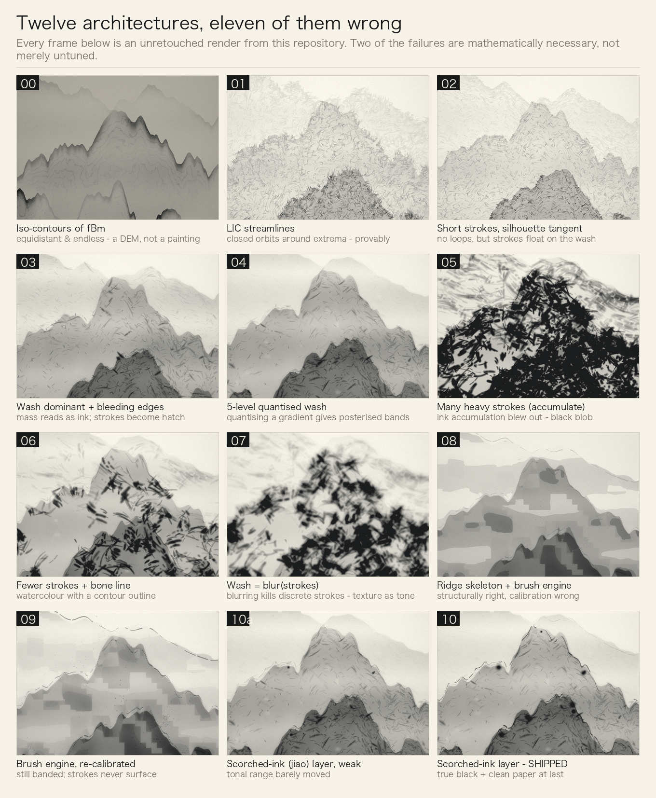
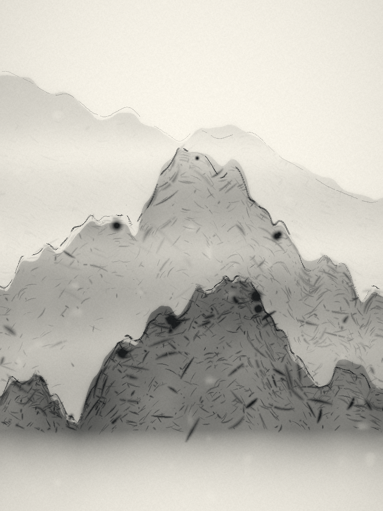

# Ink Wash — procedural Chinese ink landscapes

Generate a Chinese ink-wash (水墨) landscape from a single integer seed.
**No AI. No model. No weights. No GPU. No network.**

Every pixel is computed in the browser from:

- a seeded PRNG (`mulberry32`)
- 2D value noise → fractional Brownian motion (`fBm`)
- **ridged multifractal** height profiles for mountain silhouettes
- iso-contour extraction for the ink lines
- a paper/wash compositing pass

The whole renderer is ~300 lines of dependency-free JavaScript.

---



*A pure-math ink-wash renderer. Twelve architectures were tried; eleven were wrong.
Every frame is an unretouched render from this repository — see [What didn't work](#what-didnt-work-and-why--the-actual-design-lessons)
for the reason each one failed.*



---

## Try it

Open `index.html`. It renders on load, no signup, no build step, no server.

```bash
# any static server works, or just open the file
python3 -m http.server 8080
```

## Command line (same code path as the browser)

```bash
node tools/render.js --seed 7 --w 1000 --h 1333 --out out/seed7.png
node tools/render.js --seed 101 --w 720 --h 960   --out out/mobile.png
```

Options: `--seed` `--w` `--h` `--ink` (wash strength) `--out`.

---

## Why this is not AI

The claim is falsifiable, and that is the point:

1. **Determinism.** The same seed produces a **byte-identical PNG** every time.
   A model sampling at temperature > 0 cannot promise this. Verify:

   ```bash
   node tools/render.js --seed 7 --w 600 --h 800 --out /tmp/a.png
   node tools/render.js --seed 7 --w 600 --h 800 --out /tmp/b.png
   sha256sum /tmp/a.png /tmp/b.png     # identical
   ```

2. **No model file.** There is nothing to download. `src/inkwash.js` is the entire
   algorithm; there are no weights, no tokenizer, no inference runtime.

3. **Readable.** Every visual decision maps to a named mathematical operation
   (see below). If you do not like the output you can change one constant and
   predict what happens.

## How it works

| Step | What | Why |
|---|---|---|
| 1 | `mulberry32(seed)` | deterministic entropy; all later randomness flows from here |
| 2 | `valueNoise(x, y)` on a 256-entry permutation table | differentiable-enough, cheap, tileable |
| 3 | `fbm(...)` — sum octaves at `gain^octave`, frequency `×2.02` | the `2.02` avoids lattice-aligned artifacts |
| 4 | `ridged = 1 − \|2n − 1\|`, squared, summed | this is what turns noise into **ridges** rather than clouds |
| 5 | silhouette per band: broad `fBm` mass + small high-frequency roll, then **two smoothing passes** | broad masses read as mountains; raw high frequency reads as sawtooth noise |
| 6 | three depth bands with **air perspective** (distant = less ink) | 三远法; depth without any 3D projection |
| 7 | iso-contours of `d·2.6 + t1·1.9`, gated to the upper 55 % of each band | lines as **brush accents near the crest**, not a topographic map |
| 8 | wet-wash body `(1 − d·wash)` + a dark `crestInk` ridge edge | 墨分五色: dark at the ridge, fading into mist |
| 9 | low-frequency `macro` mask → large calm areas | 留白 — the breathing room that makes it read as painting |
| 10 | horizontal mist bands multiply the ink toward zero | 云断: mists cut the ranges apart |
| 11 | paper tone, fibre noise, very light vignette | avoid the "cheap filter" look |

There is **no 3D lighting**. Shading a height field would produce a landscape
photograph; Chinese ink painting encodes structure with *line and wash*, so the
renderer only ever manipulates ink density.

## Files

```
index.html          demo (renders on load, download PNG)
src/inkwash.js      the renderer — dependency-free, browser + Node
tools/png.js        minimal PNG encoder (Node's zlib only)
tools/render.js     CLI
out/                sample renders
```

## Cost

Static files. Runs fully client-side. A 900×1200 render takes ~0.6 s in Node and
a similar time in the browser; mobile uses 720×960 to stay fast.

## License

MIT.

---

## What didn't work (and why) — the actual design lessons

This section exists because the failures are more informative than the final image.
All intermediate renders are kept in `out/lessons/`.

### 1. Contour lines produce a topographic map, not a painting

The first version built the image from `fBm → threshold → iso-contours → fill`
(`out/lessons/00-contour-based-dem-look.png`). It reads as a DEM / GIS render.

The reason is topological, not cosmetic: **iso-contours of a smooth scalar field are
equidistant, continuous, and have no endpoints.** A brush stroke has a beginning, an
end, a taper and a pressure curve. No amount of threshold or palette tuning adds
those properties, because they are not in the primitive.

**Fix:** change the primitive. Strokes are now generated as individual directed
segments with their own length, width taper, wet/dry gaps and density.

### 2. LIC-style streamline integration of a noise field produces closed loops

The first stroke-based rewrite traced streamlines through the field perpendicular to
the gradient of a noise scalar. The result (`out/lessons/01-lic-closed-loops-noodles.png`)
is a tangle of noodles.

**The reason is mathematical.** Around every local extremum of a scalar field, the
perpendicular streamlines form closed orbits. A noise field has many local extrema,
so long integrations inevitably wind into loops. This is a property of the field —
it is not fixable by tuning step size, stroke count or opacity.

**Fix:** do not integrate a noise field. Take stroke direction from **the mountain
silhouette itself** — the tangent along the ridge for hemp-fibre strokes (披麻皴),
the downward normal for axe-cut strokes (斧劈皴) — and keep strokes short
(`out/lessons/02-short-directional-strokes-fixed.png`). Short strokes cannot close
a loop.

### 3. Getting the ratio wrong — twice, in opposite directions

- v1 was **all contour lines** → drafting, not painting.
- After the rewrite it was **all strokes** → etching / cross-hatching.
- Real ink painting is **mostly soft wet wash (渲) with strokes as sparse accents
  (皴)**, plus a few deep accents.

The current version renders the wash into its own buffer, applies a **multi-scale box
blur** to let the ink bleed into the paper, perturbs the wash boundary with noise so
the edge is not a clean silhouette cut, and composites short strokes on top
(`out/lessons/03-wash-dominant-bleeding-edges.png`).

### 4. A "density floor" creates debris

Giving every region a minimum probability of receiving a stroke guarantees isolated
marks floating on blank paper, which read as dirt. Real strokes arrive in clusters.
The generator now allows the stroke density to fall to **zero** in low-demand regions
and leaves paper instead.

---

## Design lessons — the three architectures we tried and threw away

Every intermediate render is kept in `out/lessons/`. Nothing here is retouched.

| # | What we tried | Why it failed |
|---|---|---|
| `00` | `fBm → threshold → **iso-contours** → fill` | Iso-contours of a smooth field are **equidistant, continuous, and have no endpoints**. A brush stroke has a start, an end, a taper, a pressure curve. Those properties are not in the primitive, so no amount of threshold/palette tuning produces them. This reads as a DEM / GIS render. |
| `01` | **LIC-style streamlines** through a noise field | Around every local extremum of a scalar field the perpendicular streamlines form **closed orbits**. A noise field has many extrema, so long integrations wind into loops. This is a property of the field — **not fixable by tuning step size, stroke count or opacity.** Result: a tangle of noodles. |
| `02` | Short strokes whose direction comes from the **silhouette tangent** | Strokes stopped looping, but they floated on a smooth wash: "a smooth colour block with dark scratches sprinkled on it". A stroke must sit *on* ink, not on blank paper. |
| `03` | Wash dominant + **multi-scale blur (bleeding edges)** | The mass finally looked like ink, but the strokes became a uniform mechanical hatch. |
| `04` | Soft-quantised **5-level wash** + stronger strokes | Produced **posterised bands**: quantising a smooth gradient creates visible steps. |
| `05` | **Ridge skeleton** + a real **brush engine** (pressure, ink depletion, bristle splitting) | Architecturally correct — this is where *flying-white* becomes a mechanical consequence of the outer bristles running dry first, instead of added noise. **But we could not calibrate it**: too many strokes → black blob; too few → faint scratches. See `05`–`09`. |
| `10` | Back to `03`, plus a **焦墨 (scorched-ink) layer** | The shipped frame: 10–30 bone strokes along the ridge skeleton + 3–8 near-black cores, which finally widens the tonal range to *true black + clean paper*. |

### What we still have not solved

**A stroke still does not read as a stroke.** We can describe the defect precisely and we
can point at the exact mechanism (bristle splitting + depletion) that should fix it, but our
calibration of that mechanism is not there yet. `out/v24.png` is roughly 6/10.

The honest state: **the brush engine exists and is mathematically motivated, but the
quantity/size/direction calibration that turns it into calligraphy is unsolved.** That is an
open problem, and contributions are welcome.

### Two results we are confident about

1. **Topology forbids brushwork from iso-contours.** (lesson `00`)
2. **LIC on a noise field necessarily closes into loops.** (lesson `01`)

Both are negative results, both are provable, and both are why the architecture had to change
rather than the parameters.

---

## Repository layout

```
index.html          interactive demo - opens and renders, three sliders, no signup
src/inkwash.js      the renderer (browser + Node, zero dependencies)
tools/render.js     CLI - same code path as the browser
tools/png.js        minimal PNG encoder (Node zlib only)
gallery/            eight seeds
out/lessons/        the twelve failed architectures, in order  <- the interesting part
out/iterations/     every intermediate build, unedited
out/shipped-seed7.png   the frame we shipped
```

## Reproduce

```bash
node tools/render.js --seed 7 --w 900 --h 1200 --out out/x.png
shasum -a 256 out/x.png            # run twice: identical (determinism is the whole claim)
```

Requires Node >= 18. No build step, no dependencies, no network access at render time.

## Sliders

The demo exposes three parameters, all of which change the output:

| Slider | Range | What it does |
|---|---|---|
| `ink` | 0.5 - 1.7 | overall ink load |
| `皴` | 0.4 - 2.2 | number of texture strokes |
| `dry` | 0.6 - 1.8 | how fast the brush runs dry (more flying-white) |

Dragging renders a 380x507 preview (~0.15 s); releasing re-renders at full size (~0.5 s).

## License

MIT - see `LICENSE`.
